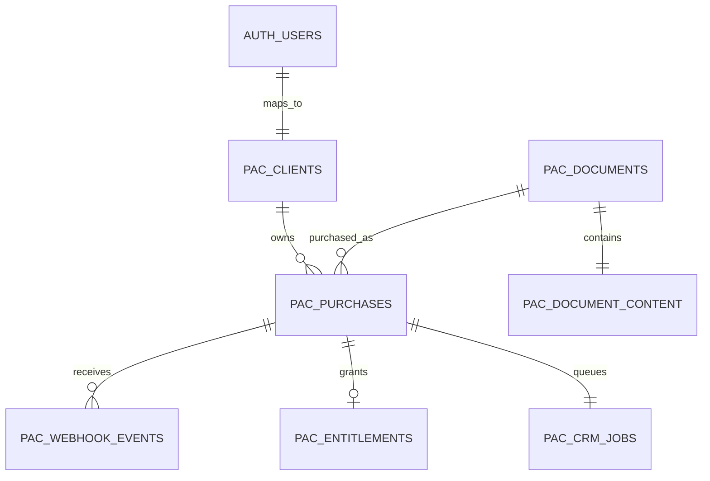

# Paid Client Access / Fieldnotes

A small assessment portal: Supabase Auth identifies a client and RLS enforces document ownership; Stripe TEST Checkout accepts a one-time payment; a verified webhook records the entitlement and a durable Zoho CRM job; the worker updates the matching Zoho Developer Edition Deal.

The browser only receives the Supabase publishable key and the signed-in user's session. Stripe credentials, the Supabase secret key, and Zoho OAuth credentials stay in server-side environment variables. Never commit `.env`.

## New developer: clone to a working local demo

These steps create your own isolated Stripe, Supabase, and Zoho test resources. Do not point your clone at another developer's production services.

### 1. Install tools and clone the repository

Install Git, Node.js 22.16 or newer, npm (included with Node.js), and the [official Stripe CLI](https://docs.stripe.com/cli/install).

If you plan to push your own changes, fork this GitHub repository first and clone your fork's URL. Otherwise, the public repository URL below is fine for a read-only clone.

```powershell
git clone https://github.com/SantoshKumarRavi/paid-client-access-assessment.git
cd paid-client-access-assessment
npm ci
```

`npm ci` installs the exact versions recorded in `package-lock.json`.

### 2. Create a Supabase project and collect its keys

1. Sign in at [Supabase](https://supabase.com/dashboard) and create a new project in an organization you control. Save the database password in your password manager.
2. In the project's **Connect** panel, copy the Project URL and publishable key. In **Project Settings > API Keys**, create/copy the secret key. The project supports the current `sb_publishable_...` and `sb_secret_...` keys and legacy `anon` / `service_role` keys.
3. Copy `.env.example` to `.env`, then enter the project URL in `SUPABASE_URL`, the publishable key in `SUPABASE_PUBLISHABLE_KEY`, and the secret key in `SUPABASE_SECRET_KEY`.
4. The publishable key is used in the browser and is safe to expose; RLS still controls its data access. The secret key bypasses RLS and must only be used by the API/operator scripts. Never put it in `VITE_*` variables, browser code, a screenshot, or Git.
5. Set `APP_URL=http://localhost:4242` and `PORT=4242` in `.env`.

Official references: [Supabase API keys](https://supabase.com/docs/guides/getting-started/api-keys) and [Supabase migrations](https://supabase.com/docs/guides/local-development/database-migrations).

### 3. Apply the database migrations once

For this repository, the simplest first setup is the Supabase Dashboard's **SQL Editor**:

1. Open **SQL Editor > New query**.
2. Open `supabase/migrations/001_paid_access.sql` from your clone, copy its entire contents, and run it.
3. Repeat for `002_crm_environment.sql`, then `003_strict_payment_validation.sql`, in that order.
4. Confirm that the seven `pac_*` tables appear under **Table Editor > public**.

Each file contains its own `BEGIN` and `COMMIT`. Apply each file once to a new, empty assessment project. Do not paste a migration into a project where it has already run: the first migration creates tables and the second/third modify them. For a future code release with no database change, do not run migrations. If a future code change needs a schema change, create and review a new numbered migration, then apply that new migration once to each target environment.

This repository does not include a Supabase CLI project config/history baseline for the already-provisioned project. Do not blindly run `supabase db push` against an existing database; first establish and compare migration history as described in the linked Supabase migration guide.

### 4. Create a Stripe sandbox and webhook credentials

1. Sign in to [Stripe](https://dashboard.stripe.com/), use the account picker to create or select an isolated **Sandbox**, and keep that sandbox selected.
2. Open **Developers / Workbench > API keys** for that sandbox and copy its **secret test key** (starts `sk_test_`) to `STRIPE_SECRET_KEY` in `.env`. This assessment rejects live keys. There is no need to create a Stripe Product or Price: the backend builds a fixed USD 19.00 Checkout item from the database document price.
3. Run `stripe login` in a terminal and approve the browser login. The CLI uses the test key from `.env` when the project listener starts.
4. After configuring the key, start the listener in Terminal 1:

   ```powershell
   npm run stripe:listen
   ```

5. The listener prints a signing secret starting `whsec_`. Copy it into `STRIPE_WEBHOOK_SECRET` in `.env`, then start/restart the app in Terminal 2 with `npm run dev`.
6. Keep the listener running while testing locally. This local `whsec_` is different from the signing secret for a deployed Dashboard webhook endpoint; never interchange them.

Use the official [Stripe API key guide](https://docs.stripe.com/keys), [Stripe CLI](https://docs.stripe.com/stripe-cli), [webhook guide](https://docs.stripe.com/webhooks), and [test card guide](https://docs.stripe.com/testing).

### 5. Create a Zoho CRM Developer Edition and OAuth credentials

Use the Zoho org's own data center throughout this process. For the India account used by this project:

- Developer Edition sign-in: [developers.zoho.in/crm](https://developers.zoho.in/crm/tab/Home/begin)
- API Console: [api-console.zoho.in](https://api-console.zoho.in/)
- `ZOHO_ACCOUNTS_URL=https://accounts.zoho.in`
- `ZOHO_API_URL=https://developer.zohoapis.in`

Steps:

1. Sign in to Zoho. If you do not yet have a Developer Edition CRM org, use Zoho's [Developer Edition page](https://www.zoho.com/crm/developer/developer-edition.html) and create/enable the Developer Edition. Open the Developer CRM itself and confirm that **Deals** is available. A regular Enterprise trial or Production org is a separate environment.
2. Open the regional API Console and create a **Self Client**. This is the backend-to-backend OAuth client type for a standalone integration.
3. In its **Client Secret** tab, copy the Client ID and Client Secret into `ZOHO_CLIENT_ID` and `ZOHO_CLIENT_SECRET` in `.env`.
4. In **Generate Code**, request only these scopes, separated by commas:

   ```text
   ZohoCRM.modules.deals.READ,ZohoCRM.modules.deals.CREATE,ZohoCRM.modules.deals.UPDATE
   ```

5. Choose a short validity duration and descriptive purpose. When prompted, choose the correct portal, **Developer** environment, and the Developer Edition CRM organization. Do not choose Production or the separate trial org. Generate the one-time grant code and exchange it promptly; it expires and can only be exchanged once.
6. Exchange the grant code at the same region's token endpoint (`https://accounts.zoho.in/oauth/v2/token`) with `grant_type=authorization_code`, `client_id`, `client_secret`, and `code`. For a Self Client, no redirect URI is registered; if the console/client setup asks for one, pass that exact registered value. Here is a Windows PowerShell example that keeps the client secret and grant out of command history and does not print the returned tokens:

   ```powershell
   $clientId = Read-Host 'Zoho Client ID'
   $secretSecure = Read-Host 'Zoho Client Secret' -AsSecureString
   $grantSecure = Read-Host 'One-time Zoho Grant Code' -AsSecureString
   $secret = [System.Net.NetworkCredential]::new('', $secretSecure).Password
   $grant = [System.Net.NetworkCredential]::new('', $grantSecure).Password
   $body = @{
     grant_type = 'authorization_code'
     client_id = $clientId
     client_secret = $secret
     code = $grant
   }
   # Only if this client setup registered a redirect URI, uncomment and enter that exact URI:
   # $body.redirect_uri = 'https://your-registered-redirect.example/callback'
   $tokenResponse = Invoke-RestMethod -Method Post `
     -Uri 'https://accounts.zoho.in/oauth/v2/token' `
     -ContentType 'application/x-www-form-urlencoded' -Body $body
   $tokenResponse | Select-Object api_domain, token_type, expires_in
   $tokenResponse.refresh_token | Set-Clipboard
   # Paste the clipboard value into ZOHO_REFRESH_TOKEN in the local .env, then clear it.
   Remove-Variable secretSecure, grantSecure, secret, grant, body, tokenResponse
   ```

   `Set-Clipboard` is built into Windows PowerShell. On another OS, put the refresh token directly into your local secret manager or ignored `.env` without printing it. The response includes a short-lived access token and a long-lived refresh token. Put only the refresh token in `ZOHO_REFRESH_TOKEN` in `.env`; the server obtains access tokens from it. Do not print, commit, or paste any grant/access/refresh token into the browser.
7. Set `ZOHO_PAID_STAGE=Closed Won`. Confirm `ZOHO_ACCOUNTS_URL` and `ZOHO_API_URL` exactly match the data center and Developer environment selected above. This project's configuration supports India, US, and EU origins; see `server/config.ts` before using another region.

Zoho access/refresh tokens are tied to both the selected organization/environment and data center. A token issued for Production or the wrong regional domain cannot be used for this Developer Edition integration. Read [Zoho's Self Client authorization instructions](https://www.zoho.com/crm/developer/docs/api/v8/auth-request.html), [scopes](https://www.zoho.com/crm/developer/docs/api/v8/scopes.html), and [token exchange/refresh guide](https://www.zoho.com/crm/developer/docs/api/v8/access-refresh.html).

### 6. Finish `.env`, seed fictional clients, and run the app

Check that `.env` has these values filled (the secret values are copied from the providers, not this README):

```dotenv
APP_URL=http://localhost:4242
PORT=4242
SUPABASE_URL=https://<project-ref>.supabase.co
SUPABASE_PUBLISHABLE_KEY=sb_publishable_...
SUPABASE_SECRET_KEY=sb_secret_...
STRIPE_SECRET_KEY=sk_test_...
STRIPE_WEBHOOK_SECRET=whsec_...
ZOHO_ACCOUNTS_URL=https://accounts.zoho.in
ZOHO_API_URL=https://developer.zohoapis.in
ZOHO_CLIENT_ID=...
ZOHO_CLIENT_SECRET=...
ZOHO_REFRESH_TOKEN=...
ZOHO_PAID_STAGE=Closed Won
CRM_WORKER_ENABLED=true
DEMO_PASSWORD=<choose-a-strong-test-only-password>
DEMO_EMAIL_PREFIX=dev-
```

In Terminal 1, keep `npm run stripe:listen` running. In Terminal 2:

```powershell
npm run seed
npm run dev
```

The seed creates three fictional, email-confirmed Supabase Auth users (`dev-alice`, `dev-bob`, `dev-charlie` at `example.test`), creates or reuses one Zoho Developer Edition Deal per user, and saves their stable user-to-Deal mapping in `pac_clients`. It does not mark them paid. Use the value of `DEMO_PASSWORD` to sign in. For ten accounts instead, run `npx tsx scripts/seed.ts --prefix=hr- --count=10`; this creates `hr-test-01@example.test` through `hr-test-10@example.test`. The seed can be safely rerun with the same prefix and will not reset purchases.

#### Why the seed checks Zoho before creating a Deal

The seed operation crosses two separate systems, so a process can stop between writes. For example: it creates a Zoho Deal successfully, then the computer loses its connection before the script can save that Deal ID in Supabase. If you run the seed again, the Supabase mapping is still missing. Blindly issuing another Zoho create would leave two Deals for the same test user.

To recover, the script constructs a deterministic Deal name from the fixture name and the first eight characters of that user's Supabase ID. When it sees that the `pac_clients` mapping is missing, it searches Zoho for that exact Deal name. If it finds one, it reuses the existing Zoho ID and saves the mapping. If it finds none, it creates the Deal. If it finds more than one, it stops for a person to resolve the duplicate instead of guessing. It also looks up the Supabase user by email first, so an interruption after Auth user creation does not make a second user on rerun. This handles the ordinary partial-failure case; it is a recovery mechanism, not a distributed transaction across Zoho and Supabase.

Open <http://localhost:4242>, sign in with a seeded user, choose **Unlock document**, and use Stripe's test Visa `4242 4242 4242 4242`, any future expiry, and any 3-digit CVC. No funds move. Wait for the verified webhook; the app should show payment confirmed, access granted, and CRM synced. Then check **Read document**. Inspect the matching Zoho Deal in **Developer Edition > CRM > Deals**. The test card behavior is documented by [Stripe](https://docs.stripe.com/testing).

### 7. Run automated checks

```powershell
npm test
npm run build
```

The live and outage tests require deliberately prepared fixtures and test services; follow [Tests and evidence](#tests-and-evidence) below. Do not run failure/replay tests against a shared or live payment environment.

## Database design: tables and relationships

The `pac_` prefix keeps this assessment's schema isolated from unrelated tables in a Supabase project.

| Table | One row represents | Why it exists |
|---|---|---|
| `pac_clients` | One authenticated user mapped to one Zoho Deal and CRM environment | The stable cross-system link. Webhook processing uses user/Deal IDs, not mutable email matching. |
| `pac_documents` | A catalog item and its fixed price/currency | Checkout amounts are sourced and validated server-side. |
| `pac_document_content` | The protected content body for a document | Kept separate from public catalog metadata and returned only when the user has an entitlement. |
| `pac_purchases` | One checkout attempt and its eventual payment state | Stores immutable user/document/Deal/environment/amount/session references and `pending`, `paid`, or `expired` status. |
| `pac_webhook_events` | One Stripe event ID accepted by fulfillment | Primary key deduplicates Stripe retries. |
| `pac_entitlements` | One user’s access to one document | Unique user/document key prevents duplicate access records; a foreign key ties it to the paid purchase. |
| `pac_crm_jobs` | One durable Zoho sync job per purchase | Tracks retries, attempts, leases, errors, and successful sync without making CRM availability part of payment fulfillment. |

Relationship overview:



**Design rationale:** payment and identity are separate authorities. Stripe's signature verifies the payment; the server validates that payment against a stored purchase; Supabase records entitlement and ownership; Zoho is synchronized as a downstream CRM projection. The transaction records the entitlement and CRM job together, so a Zoho outage cannot undo paid access. RLS policies protect user reads; privileged fulfillment functions are callable only by the server role.

## What each migration does

Run `001`, `002`, `003` once in order on a new empty assessment database. These files are not app-start scripts and are not run for every deployment.

### `001_paid_access.sql` - base schema, access controls, and payment/worker functions

- `-- Isolated assessment tables...` documents scope. `BEGIN` and `COMMIT` make the file all-or-nothing.
- `CREATE TABLE pac_clients`: `user_id` is the primary key and foreign key to `auth.users`; `ON DELETE RESTRICT` prevents deleting an identity while its CRM mapping exists. `zoho_deal_id` is required, unique, numeric-only text because Zoho IDs may exceed safe JavaScript integer precision. `display_name` is required.
- `CREATE TABLE pac_documents`: stores document ID, title, summary, positive integer `price_cents`, and a three-letter lowercase currency. Integer cents avoid floating-point money errors.
- `CREATE TABLE pac_document_content`: one protected text body per document, linked to the catalog row. Keeping the content separate lets RLS guard it independently.
- `CREATE TABLE pac_purchases`: captures a generated purchase UUID; user/document and the Zoho Deal ID; amount/currency snapshot; constrained `pending`/`paid`/`expired` status; unique Stripe Checkout Session ID; checkout expiry; creation and paid timestamps. The composite unique key supports a foreign key that proves an entitlement references the same purchase, user, and document.
- `CREATE UNIQUE INDEX pac_one_pending_purchase`: permits at most one pending checkout for a user/document while retaining older expired purchase history.
- `CREATE TABLE pac_entitlements`: primary key `(user_id, document_id)` means one access grant per user/document; `purchase_id` is unique and the composite foreign key binds this grant to the matching purchase.
- `CREATE TABLE pac_webhook_events`: the Stripe `event_id` primary key makes event receipt idempotent; `purchase_id` records which purchase it affected.
- `CREATE TABLE pac_crm_jobs` and `pac_crm_due` index: one row per purchase stores pending/processing/synced status, attempts, next retry time, lease expiry/token, last error, and synced timestamp. The partial index makes due-job scans efficient.
- The seven `ALTER TABLE ... ENABLE ROW LEVEL SECURITY` statements turn on RLS for each assessment table. `REVOKE ALL` removes the default client access first. `GRANT SELECT ... TO authenticated` allows signed-in users to read only where policies permit; no client write access is granted. `GRANT ALL ... TO service_role` gives the trusted server/operator API access (the Supabase secret key must remain server-only).
- `CREATE POLICY pac_client_self`, `pac_purchases_self`, `pac_entitlements_self`, and `pac_jobs_self` restrict each row to `auth.uid()`. `pac_catalog` allows signed-in users to read catalog metadata. `pac_content_paid` allows the protected body only when a matching entitlement exists for that same user and document.
- `CREATE FUNCTION pac_begin_purchase`: a `SECURITY DEFINER` server-only transaction locks the client mapping (`FOR UPDATE`), requires the client and document to exist, rejects already-owned content, expires stale pending checkouts, reuses a still-pending checkout, or creates a new purchase snapshot from the catalog and mapped Deal. `set search_path=''` and explicit `public.` names reduce search-path attacks.
- `CREATE FUNCTION pac_fulfill`: locks the purchase row and validates Stripe session, user, Zoho Deal, document, amount, and currency against stored values. It inserts the event ID with `ON CONFLICT DO NOTHING`; replay returns `false`. For the first valid paid event it marks the purchase paid and inserts the entitlement plus CRM job in the same database transaction.
- `CREATE FUNCTION pac_claim_job`: a CTE selects one due job using `FOR UPDATE SKIP LOCKED`, so concurrent workers don't claim the same row. It marks the job `processing`, increments attempts, sets a two-minute lease and random fencing token, and returns the IDs needed by the Zoho worker.
- `CREATE FUNCTION pac_finish_job`: the worker must supply the current lease token. Success marks `synced`; failure returns the job to `pending`, records the error and exponential retry time (capped at one hour), and clears the lease. A stale worker token cannot overwrite a newer attempt.
- `REVOKE ALL ON FUNCTION ... FROM public, anon, authenticated` then `GRANT EXECUTE ... TO service_role` closes the RPCs to browser clients and allows only the trusted server to call them.
- The two `INSERT` statements create the sample catalog entry (`$19.00 USD`) and its protected example content. Final `COMMIT` publishes the whole migration.

### `002_crm_environment.sql` - bind each Deal to Production or Developer explicitly

- `BEGIN` / `COMMIT` keep this schema transition atomic.
- Two `ALTER TABLE ... ADD COLUMN` statements add a constrained `zoho_environment` (`production` or `developer`) to client mappings and purchases. Existing rows receive a safe default of `production`; newly seeded Developer Edition fixtures explicitly store `developer`.
- `DROP CONSTRAINT` removes the old global uniqueness rule on Deal ID. `ADD CONSTRAINT ... UNIQUE(zoho_environment, zoho_deal_id)` permits a same-number ID in different CRM environments while forbidding duplicates inside one environment.
- The old `pac_begin_purchase` signature is dropped and recreated with `p_environment`. It checks that the client mapping is for the requested environment and snapshots environment into the purchase.
- The old `pac_fulfill` signature is replaced to validate environment as another immutable part of the payment identity.
- The old `pac_claim_job` signature is replaced to join purchases and claim only jobs belonging to the worker's configured CRM environment. This prevents a Developer Edition worker from updating Production records or vice versa.
- The final `REVOKE`/`GRANT` statements reapply server-only function permissions to the new function signatures.

### `003_strict_payment_validation.sql` - make fulfillment identity checks NULL-safe

- `BEGIN` / `COMMIT` make both function replacements atomic.
- `CREATE OR REPLACE FUNCTION pac_begin_purchase` retains its signature and permissions but changes the environment comparison to `IS DISTINCT FROM`. In SQL, `NULL <> value` is unknown rather than true; `IS DISTINCT FROM` treats null as a mismatch, closing that edge case.
- `CREATE OR REPLACE FUNCTION pac_fulfill` applies the same null-safe comparison to session, user, Deal, document, amount, currency, and CRM environment. A missing/null value cannot slip through a comparison.
- The replay-safe event insert, paid update, entitlement insert, and CRM outbox insert remain unchanged, preserving existing correct behavior.

### Migration release rule

A new clone must apply all three historical migrations once, in sequence. An established database must not replay them. A routine release with only application/UI changes runs no migrations. A release that introduces a database change adds a new migration file (for example `004_...sql`) and applies only that new migration once to the intended database, after reviewing it and backing up important data. Do not use `DROP`, `RESET`, or re-run `001` to repair a mismatch; inspect migration state and write a forward migration instead.

## Local environment reference

`.env.example` lists every required variable. Copy it to `.env`; never commit `.env`.

| Variable | Get it from / purpose |
|---|---|
| `APP_URL`, `PORT` | Local origin `http://localhost:4242` and port `4242`. `APP_URL` must not end in `/`. |
| `SUPABASE_URL` | Supabase Project URL / Connect panel. |
| `SUPABASE_PUBLISHABLE_KEY` | Supabase Connect panel or Settings > API Keys. Browser-safe; RLS still applies. |
| `SUPABASE_SECRET_KEY` | Supabase Settings > API Keys. Server-only elevated key. |
| `STRIPE_SECRET_KEY` | Stripe sandbox API keys; must start `sk_test_`. |
| `STRIPE_WEBHOOK_SECRET` | Local Stripe CLI listener's `whsec_...` for local runs; production endpoint has its own separate secret. |
| `ZOHO_CLIENT_ID`, `ZOHO_CLIENT_SECRET`, `ZOHO_REFRESH_TOKEN` | Regional Zoho API Console Self Client and one-time Developer-org grant exchange. Server-only. |
| `ZOHO_ACCOUNTS_URL`, `ZOHO_API_URL` | Must match Zoho region and Developer environment; see `server/config.ts`. |
| `ZOHO_PAID_STAGE` | Stage to set on successful payment; default `Closed Won`. |
| `CRM_WORKER_ENABLED` | `true` for local background retries; `false` on Vercel serverless where the webhook makes the immediate attempt and Cron handles fallback. |
| `CRON_SECRET` | Random 32+ character secret only required for Vercel's protected retry Cron route. |
| `DEMO_PASSWORD`, `DEMO_EMAIL_PREFIX` | Operator-only seed settings. If password is absent, the seed generates one and writes it to ignored `.env`. |

## Optional: deploy your clone to Vercel

1. Create a Vercel project connected to your own GitHub fork/repository, or use the Vercel CLI.
2. Add the production environment variables from the table above. Set `APP_URL` to the final `https://...vercel.app` origin (no trailing slash), `CRM_WORKER_ENABLED=false`, and a random `CRON_SECRET`. Add the Supabase secret key, Stripe test secret/signing secret, and Zoho secrets as encrypted Vercel environment variables, never as `VITE_` variables.
3. Deploy with `vercel --prod` (after `vercel login` and `vercel link`) or let the connected GitHub main branch deploy. Redeploy after changing environment variables.
4. In the same Stripe sandbox, create a webhook destination pointing to `https://<your-domain>/api/webhook` for `checkout.session.completed` and `checkout.session.async_payment_succeeded`. Copy that endpoint's `whsec_` to Vercel's `STRIPE_WEBHOOK_SECRET` and redeploy. It is not the local Stripe CLI secret.
5. Visit `/api/health`, then register/sign in, buy with a test card, and confirm Supabase access plus the matching Zoho Developer Edition Deal.

Vercel runs the Express API as a Node function and serves the built React assets. The paid webhook immediately attempts CRM sync after database fulfillment. Failed jobs remain durable and can be retried from the portal; Hobby Cron is daily, so use a worker/queue with a shorter schedule if your required retry latency is lower.
## Tests and evidence

```powershell
npm test                  # Offline real PostgreSQL/PGlite, HTTP, Stripe-signature and CRM transport tests
npm run build             # TypeScript checks + production frontend build
npm run test:live         # Real Supabase + Stripe + Zoho checks after dev-alice pays
npm run crm:retry         # Process up to 25 due jobs in the configured CRM environment
npm run crm:retry -- PURCHASE_UUID  # Explicitly retry one paid purchase
```

`test:live` requires the server running, paid `dev-alice`, and a seeded unpaid `audit-bob`. Run `npm run seed`, then `npx tsx scripts/seed.ts --prefix=audit-` once. It fetches Alice's real Stripe event, re-signs that **existing event payload** with the local listener secret, sends five concurrent local replays, and checks one entitlement, one CRM job, and unchanged Zoho modification time/Description. This is a local replay test, not a claim of five new deliveries originating at Stripe. The original payment is delivered by the actual Stripe CLI listener.

`stripe trigger checkout.session.completed` creates a generic fixture without this app's stable IDs and does not demonstrate a valid portal purchase. Use the portal checkout instead.

### Manual acceptance tests

1. Sign in as a fresh prefixed Alice. The document is locked. Direct client queries cannot read `pac_document_content`.
2. Select **Unlock document**. In the Stripe **Sandbox** form, enter fictional email/name and card `4242 4242 4242 4242`, any future expiry, and any three-digit CVC. Do not enter a real card or save a payment method.
3. Pay. Check the listener returns HTTP 200. The portal polls Supabase every five seconds. Payment becomes confirmed, document access granted, and CRM sync completed. Open **Read document**.
4. In Supabase, trace the same purchase UUID through `pac_purchases`, `pac_webhook_events`, `pac_entitlements`, and `pac_crm_jobs`. Match its `user_id`, `stripe_session_id`, `zoho_deal_id`, and `zoho_environment`.
5. In Zoho Developer Edition, find the Deal named `PAC Assessment - Alice Morgan - <user-id-prefix>`. Its Stage is Closed Won. Description retains the original notes and contains `[PAC_PAID:<purchase UUID>]` plus the Stripe test session ID.
6. Run `npm run test:live` using the baseline `dev-` fixtures. Five concurrent replays return `granted:false`; the Deal is not modified again.
7. In a separate browser session, sign in as unpaid Bob. He has no Alice purchase, entitlement, CRM job, or document. Client-side inserts/updates and privileged RPCs are denied, even if a caller knows Alice's UUID. Bob's retry request for Alice returns 404.
8. For a decline test on a fresh client, use `4000 0000 0000 0002`. Stripe shows a decline; the purchase stays pending and no entitlement is created. Retrying with the successful test card can complete that same Checkout.

### CRM outage and recovery

Use a **fresh** fixture; never remove a paid entitlement to stage a failure.

1. Set `CRM_WORKER_ENABLED=false` in `.env` and restart the server before the purchase. Use a fresh Charlie (or set a new `DEMO_EMAIL_PREFIX` and seed that prefix).
2. Complete Charlie's real Stripe test checkout. Supabase grants access and creates the pending CRM job without contacting Zoho.
3. Run `npm run test:outage`. This uses the normal worker/adapter with an injected HTTP 503 transport in the **operator script only**. It verifies pending status, a persisted error, a scheduled retry, and continued client document access. It does not shut down Zoho or expose a failure switch in the public app.
4. In Charlie's portal select **Retry CRM sync**, or run `npm run crm:retry -- PURCHASE_UUID`. The normal real Zoho adapter updates the exact Deal and marks the job synced. Access remains active throughout.
5. Restore `CRM_WORKER_ENABLED=true` and restart the app. Automatic retries use exponential delay, capped at one hour; an explicit retry bypasses the delay but cannot take an active lease.

Raw local run results are in ignored `test-results/`; selected sanitized evidence is included under `docs/evidence/`. The PDF contains the final environment, HLD, LLD, state flows, requirement coverage, observed tests, tradeoffs, and a 15-minute interview walkthrough.

## Core correctness decisions

- **Stable IDs, never email matching:** authenticated Supabase user UUID -> server-owned client/Deal/environment mapping -> immutable purchase UUID -> Stripe session metadata + client reference. Price, currency, Deal and environment are validated again inside the fulfillment transaction.
- **Verified payment only:** raw request bytes are verified before JSON parsing. Only paid one-time `checkout.session.completed` or `checkout.session.async_payment_succeeded` test events can fulfill. A redirect cannot grant access.
- **Atomic entitlement + outbox:** the event receipt, paid purchase, unique entitlement, and unique CRM job commit together. Database failure returns 500 so delivery can retry; CRM availability is outside that transaction.
- **Two levels of deduplication:** primary-key Stripe event receipt and paid-purchase state handle repeated/different events; a unique `(user_id,document_id)` entitlement and one job per purchase enforce business invariants. The server reuses pending purchases and Stripe's idempotency key when creating Checkout.
- **Durable retries:** PostgreSQL `FOR UPDATE SKIP LOCKED`, a two-minute lease, and a random lease token coordinate workers. Fenced completion cannot overwrite a newer attempt. A crash leaves work recoverable after lease expiry.
- **CRM reconciliation:** GET the Deal before PUT; a receipt marker detects an earlier successful update whose response was lost. Preserve Description; use `If-Unmodified-Since`; suppress workflow/cadence triggers for the assessment update. Validate per-record success even when HTTP succeeds.
- **Security at the database:** authenticated clients get SELECT only; RLS filters ownership. Document content requires an entitlement. Webhook receipts and privileged RPCs have no client grants. Server routes verify Supabase JWTs and retry ownership. Development file serving denies secrets, server code, migrations and documentation. Production serves only `dist/`.
- **Environment safety:** production/trial and Developer Edition have separate Deal namespaces. Checkout validates the mapping's environment, metadata carries it, and workers claim only their configured environment. Earlier trial evidence remains intact; the final configured flow uses Developer Edition.

## Limits to explain honestly

Zoho's ordinary record update API is not a distributed transaction participant and does not provide a general idempotency key. Normal webhook replays do not create another CRM write. Read-before-write receipt reconciliation handles common timeout/crash cases. Leases and conditional writes reduce races, but this is **not an absolute mathematical exactly-once guarantee** across arbitrarily delayed external requests, concurrent manual edits, or a provider whose timestamp resolution is coarse. Production would add a dedicated immutable unique CRM receipt field or provider-supported operation ledger and reconciliation/alerts.

Refunds, disputes, subscription renewals, revocation, multiple catalog documents, document download/DRM, and a customer provisioning UI are outside this one-time-access assessment. Delayed-success handling is implemented and tested with signed fixtures; real browser purchases use cards. Large files should move to private Supabase Storage with entitlement-aware object policies or short-lived downloads. An authorized reader can still copy content they can read; RLS is authorization, not DRM.

No credentials are committed or included in the submission archive. Existing `.env.trial` is a local-only backup of the earlier trial integration. The final environment uses `.env` and `dev-` fixtures. Do not submit either secret file.

## Source map

| Area                                         | Implementation                                             |
| -------------------------------------------- | ---------------------------------------------------------- |
| Portal and direct Supabase reads             | `web/main.tsx`, `web/styles.css`                           |
| Raw webhook, authenticated checkout/retry    | `server/app.ts`, `server/payments.ts`                      |
| Credentials and server Supabase clients      | `server/config.ts`, `server/db.ts`                         |
| Durable worker and real Zoho adapter         | `server/worker.ts`, `server/zoho.ts`                       |
| Tables, RLS, locks and RPCs                  | `supabase/migrations/001_*.sql` through `003_*.sql`        |
| Repeatable sample data and operator commands | `scripts/seed.ts`, `scripts/retry.ts`                      |
| Offline / live / outage tests                | `tests/`, `scripts/live-test.ts`, `scripts/outage-test.ts` |

References: [Stripe fulfillment](https://docs.stripe.com/checkout/fulfillment), [Stripe webhook signatures](https://docs.stripe.com/webhooks/signature), [Supabase RLS](https://supabase.com/docs/guides/database/postgres/row-level-security), [Zoho update records](https://www.zoho.com/crm/developer/docs/api/v8/update-records.html), [Zoho environments](https://help.zoho.com/portal/en/community/topic/kaizen-5-environments-and-domains-in-zoho-crm-part-1-2).
