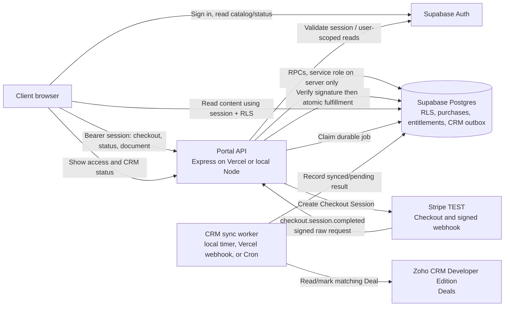
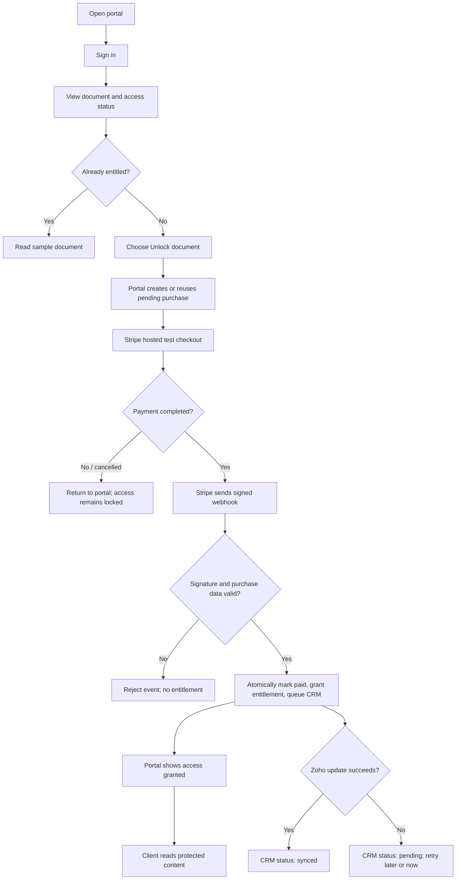
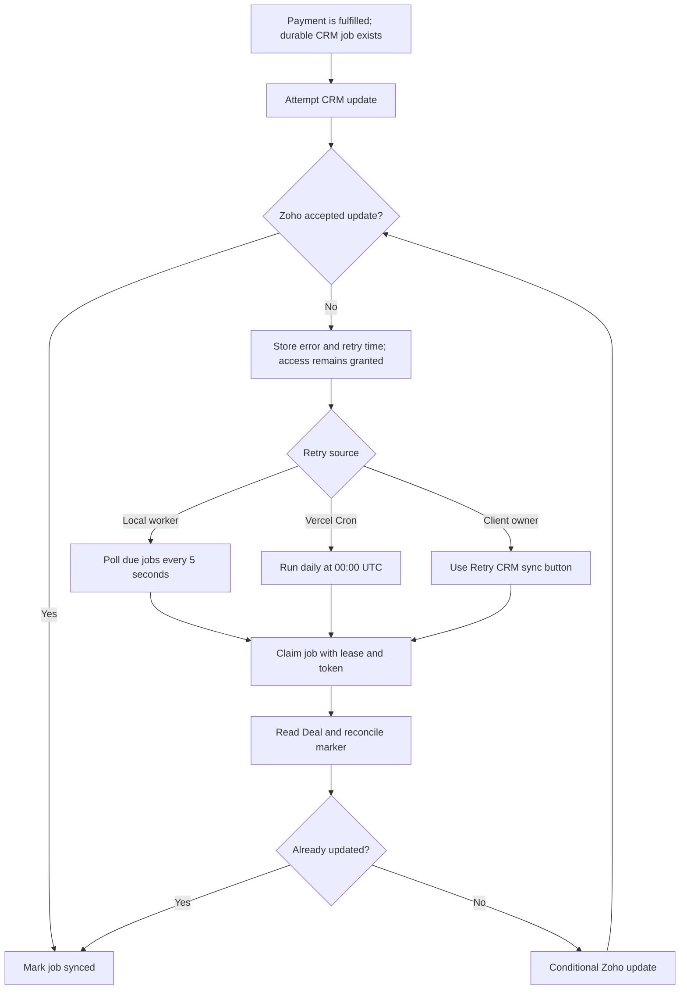

# Architecture: HLD and LLD

This document describes the implemented assessment portal. Stripe TEST handles checkout, Supabase Auth and Postgres own identity and access, and Zoho CRM Developer Edition receives a retryable Deal update.

## High-level design (HLD)

The browser never decides that a payment succeeded. It starts checkout through the API and receives document access only after the server validates Stripe's signed webhook and commits the purchase and entitlement to Supabase.



### Trust boundaries and ownership

| Component | Responsibility | Trust boundary |
|---|---|---|
| Browser | Sign-in, begin checkout, display purchase/access/CRM state, read entitled content | Holds only the Supabase publishable key and the user's session. Never receives Stripe, Zoho, or Supabase server credentials. |
| Portal API | Validate user sessions, create Checkout Sessions, verify webhook signatures, fulfill payments, claim/retry CRM jobs | Server-only secrets. The webhook is verified against the exact raw request body before processing. |
| Supabase Auth + Postgres | User identity, stable client-to-Deal binding, purchase history, entitlement, protected document content, durable CRM outbox | RLS limits browser reads to the authenticated user's rows. Privileged RPCs and the service key are server-only. |
| Stripe TEST | Hosted card checkout and signed payment events | Redirects are not proof of payment; only a verified event can fulfill a purchase. |
| Zoho Developer Edition | CRM projection of a successfully paid purchase | Downstream dependency. Failure leaves access granted and CRM work pending for retry. |

## Low-level design (LLD)

### Payment and access sequence

```mermaid
sequenceDiagram
    autonumber
    actor User
    participant Browser
    participant API as Express API
    participant Auth as Supabase Auth
    participant DB as Supabase Postgres
    participant Stripe
    participant CRM as Zoho CRM

    User->>Browser: Sign in
    Browser->>Auth: Authenticate
    Auth-->>Browser: User session
    User->>Browser: Unlock sample document
    Browser->>API: POST /api/checkout + session token
    API->>Auth: Validate token and resolve user ID
    API->>DB: pac_begin_purchase(user, document, environment)
    Note over DB: Resolve immutable Zoho Deal mapping;<br/>reject already entitled; reuse open checkout
    DB-->>API: Purchase ID, amount, currency, Deal ID
    API->>Stripe: Create/reuse Checkout Session with stable IDs in metadata
    Stripe-->>Browser: Hosted Checkout URL
    User->>Stripe: Complete test card payment
    Stripe->>API: checkout.session.completed + Stripe-Signature
    API->>API: Verify signature over raw bytes; validate paid session
    API->>DB: pac_fulfill(event, purchase, session, user, Deal, doc, amount, currency, env)
    Note over DB: One transaction: validate snapshot;<br/>dedupe event; mark paid; grant entitlement;<br/>enqueue one CRM job
    DB-->>API: Fulfilled or recognized duplicate
    API-->>Browser: Stripe redirects to portal (not the authority)
    Browser->>DB: Read purchase/entitlement/content with user session
    DB-->>Browser: Only rows permitted by RLS
    opt First CRM attempt
        API->>DB: Claim job with lease and fencing token
        API->>CRM: Read Deal, then conditionally mark paid
        CRM-->>API: Update result or error
        API->>DB: Finish as synced or pending (token must still match)
    end
```

### CRM outbox and retry sequence

```mermaid
sequenceDiagram
    participant Trigger as Webhook / local worker / Vercel Cron / owner button
    participant DB as Supabase pac_crm_jobs
    participant Worker as CRM syncOne
    participant Zoho

    Trigger->>Worker: Process one job (optionally a purchase ID)
    Worker->>DB: pac_claim_job
    Note over DB: Lock one due row with SKIP LOCKED;<br/>set processing, 2-minute lease, new token
    DB-->>Worker: Purchase + Deal + lease token
    Worker->>Zoho: GET Deal (Description, Stage, Modified_Time)
    alt Marker already exists and stage is paid
        Zoho-->>Worker: Already reconciled; skip PUT
    else Deal needs update
        Worker->>Zoho: Conditional PUT with If-Unmodified-Since
        Zoho-->>Worker: Success or failure
    end
    Worker->>DB: pac_finish_job(purchase, lease token, error)
    alt Success and token still current
        DB-->>Worker: synced
    else Failure and token still current
        Note over DB: Store error; set pending and next retry<br/>with exponential backoff, capped at 1 hour
        DB-->>Worker: pending
    else Lease expired and another worker reclaimed it
        DB-->>Worker: Reject stale finish (lease_lost)
    end
```

On a local run, `CRM_WORKER_ENABLED=true` starts a timer that polls every five seconds and processes up to five due jobs per tick. On Vercel, the webhook attempts CRM immediately after the database transaction, and `vercel.json` schedules the authenticated cron endpoint daily at 00:00 UTC. An owner can also request an immediate retry from the portal. A worker only updates the job row if its lease token is still current.

### Idempotency and failure boundaries

- Stripe's event ID is stored as a unique webhook receipt. Re-delivery does not create a second entitlement or CRM job.
- The purchase UUID, user ID, document ID, Zoho Deal ID, CRM environment, amount, currency, and Checkout Session ID are checked against the server-created purchase snapshot before fulfillment.
- The entitlement key is `(user_id, document_id)` and the CRM job key is `purchase_id`, providing database uniqueness in addition to event deduplication.
- Payment, entitlement, event receipt, and CRM outbox insertion are committed atomically in Postgres. Zoho is outside that transaction, so its failure cannot roll back paid access.
- Zoho updates preserve the current Description, add a purchase marker, and use `Modified_Time` as a conditional-write guard. A retry first checks the marker to reconcile a previous update whose response may have been lost.
- The portal retry endpoint verifies that the signed-in owner has a paid purchase before attempting its CRM job.

## User-flow diagrams

### Successful purchase



### Ownership and document access

```mermaid
flowchart TD
    A[Browser requests document or purchase status] --> B[Supabase validates user session]
    B --> C{Valid authenticated user?}
    C -->|No| D[Reject request]
    C -->|Yes| E[Query using user session; RLS evaluates auth.uid()]
    E --> F{Row belongs to this user?}
    F -->|No| G[Return no row / deny access]
    F -->|Yes| H{Document content requested?}
    H -->|No| I[Return own purchase and entitlement state]
    H -->|Yes| J{Matching entitlement exists?}
    J -->|No| K[Content is not visible]
    J -->|Yes| L[Return entitled document content]
```

### CRM recovery path



For the table-by-table schema, constraints, and RLS design, see [Database schema](database-schema.md).
