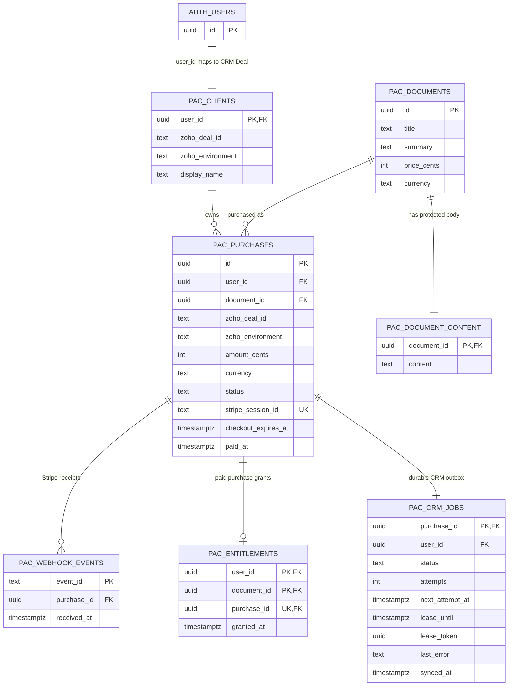

# Database schema and access model

The schema is implemented in `supabase/migrations/001_paid_access.sql`, then extended by `002_crm_environment.sql` and hardened by `003_strict_payment_validation.sql`. Apply them in numeric order to a new assessment database. These are versioned database changes, not runtime scripts; do not reapply them for every application deployment.

## Entity relationship diagram



## What each table stores

| Table | Key and relationship | Purpose / important constraints |
|---|---|---|
| `auth.users` | Supabase-managed user ID | Authentication identity. The app never duplicates credentials in a portal table. |
| `pac_clients` | `user_id` is both PK and FK to `auth.users`; unique Deal per CRM environment | Stable mapping from authenticated identity to Zoho Deal and display name. The environment-qualified Deal uniqueness prevents mixing Developer and Production records. |
| `pac_documents` | Document UUID PK | Catalog metadata and server-owned price/currency. `price_cents` is an integer, avoiding floating-point currency values. |
| `pac_document_content` | `document_id` PK/FK to catalog | Protected body kept apart from readable catalog metadata so the database can apply stricter access rules. |
| `pac_purchases` | Purchase UUID PK; FKs to user, document; unique Stripe Session ID | Immutable snapshot of owner, document, mapped Deal/environment, amount/currency, checkout session, and payment state. One pending purchase per user/document is enforced by a partial unique index. |
| `pac_webhook_events` | Stripe `event_id` PK; purchase FK | Idempotency receipt. A repeated Stripe event conflicts with the existing primary key and cannot grant another entitlement. |
| `pac_entitlements` | Composite PK `(user_id, document_id)`; unique purchase FK | The actual access grant. The composite purchase relationship ties the grant to the same owner and document; uniqueness prevents duplicate grants. |
| `pac_crm_jobs` | `purchase_id` PK/FK; user FK | Durable outbox and retry state for Zoho. Tracks attempts, due time, lease, fencing token, error and success time. One job per purchase. |

## Main relationship and write path

1. A signed-in user ID resolves to one `pac_clients` row, which provides the stable Zoho Deal ID and CRM environment.
2. `pac_begin_purchase` snapshots that mapping and the current server-side catalog price into `pac_purchases` before Stripe checkout is created.
3. A signed Stripe webhook is checked against that snapshot. `pac_fulfill` verifies the session, user, Deal, environment, document, amount, currency, and event ID.
4. In one database transaction, fulfillment records the event, marks the purchase paid, inserts the entitlement, and inserts the CRM job. If any operation fails, the transaction rolls back as a unit.
5. A worker claims the CRM job and updates Zoho. It marks the job synced or stores an error and a retry time. A CRM outage does not remove paid access.

## Row Level Security (RLS)

RLS is enabled on all seven `pac_*` tables. Browser requests carry the signed-in user's Supabase JWT and use the publishable key. The policies use `auth.uid()` to scope client-visible rows. The service-role key bypasses RLS and is restricted to server processes and operator scripts.

| Table | Browser access | Policy intent |
|---|---|---|
| `pac_clients` | Read own mapping | `user_id = auth.uid()` |
| `pac_documents` | Read catalog | Authenticated users can see catalog metadata. |
| `pac_document_content` | Read only after purchase | A matching entitlement must exist for `auth.uid()` and this document. |
| `pac_purchases` | Read own purchase history | `user_id = auth.uid()` |
| `pac_webhook_events` | No direct browser access | Written by the privileged fulfillment function only. |
| `pac_entitlements` | Read own entitlements | `user_id = auth.uid()` |
| `pac_crm_jobs` | Read own CRM sync status | `user_id = auth.uid()` |

Browser clients do not receive insert/update/delete permissions on these tables. Server-only `SECURITY DEFINER` RPCs use an empty `search_path`, fully qualified table names, and explicit grants to `service_role`; the migrations revoke execution from `public`, `anon`, and `authenticated`.

## Migration sequence

| Migration | Schema change |
|---|---|
| `001_paid_access.sql` | Creates the seven tables, keys/indexes, RLS policies, server-only checkout/fulfillment/CRM queue RPCs, and the sample catalog/content. |
| `002_crm_environment.sql` | Adds explicit `production` / `developer` environment binding to client and purchase records, then updates RPC signatures and constraints so Deal IDs are unique within an environment. |
| `003_strict_payment_validation.sql` | Uses null-safe comparisons in payment validation so missing webhook fields cannot bypass identity/amount checks; preserves the existing RPC signatures and permissions. |

Verify RLS state from Supabase SQL Editor:

```sql
select schemaname, tablename, rowsecurity
from pg_tables
where schemaname = 'public' and tablename like 'pac_%'
order by tablename;
```

`rowsecurity = true` means RLS is enabled for that table. For detailed setup and release guidance, see the [README database section](../README.md#database-design-tables-and-relationships).
